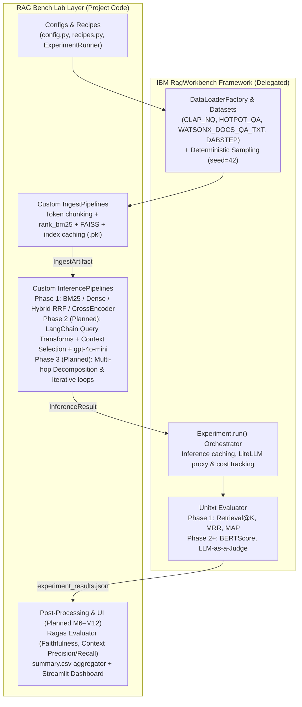

# RAG Bench Lab — Architecture & System Overview

Here is an architectural walkthrough of **RAG Bench Lab** across both its current implementation (Phase 1) and planned design (Phases 2–4), based on the codebase, ADRs (`0001`–`0012`), and milestones.

---

## 1. Recipes (What they are, Purpose, Schema & Methodology)

### What is a Recipe and what is its purpose?
A **Recipe** is a complete, immutable specification of one RAG pipeline configuration—selecting one option for each stage of the pipeline:
`Query Transformation → Retrieval → Fusion → Reranking → Context Selection → Generation`

**Why Recipes exist (The Decision-Tree Methodology — ADR-0009):**
If you crossed every option across all 6 stages, you would get ~300 combinations (or 23 "sensible" candidates, `R0`–`R22`, called the **Recipe Matrix**). Running a full grid search is too slow and makes it hard to tell *which* change caused an improvement.
Instead, Recipes are organized as an **Evaluation Decision Tree** following a strict **controlled-experiment rule**: *each new Recipe changes only one meaningful factor relative to its parent baseline.*
* **Phase 1 Ladder (`R0`–`R4`, Implemented):** `R0` (No RAG) → `R1` (BM25) → `R2` (Dense) → `R3` (Hybrid BM25+Dense w/ RRF) → `R4` (Hybrid + Cross-Encoder Reranker).
* **Phase 2 (`R5`–`R17` candidates, Planned):** Takes the winning retrieval backbone from Phase 1 and tests one **Query Transformation** (`Multi-query`, `HyDE`, `Step-back`) or one **Context Selection** strategy (`Adjacent-chunk expansion`, `Parent-context`, `Deduplication`, `Compression`) at a time, plus fixed LLM Generation (`gpt-4o-mini`).
* **Phase 3 (`R18`–`R22` candidates, Planned):** Tests **Multi-hop topologies** (`Decomposition` and `Iterative Retrieval`) on the multi-hop Scenarios (`hotpotqa` and `dabstep`).

### Recipe Schema (`src/ragbenchlab/configs/recipes.py`)
Recipes live in a single source-of-truth dictionary (`RECIPES`) as frozen `RecipeConfig` dataclasses:
* `recipe_id: str` — Short identifier (`"R0"`, `"R1"`, …, `"R4"`).
* `description: str` — Human-readable summary for logs and the Streamlit dashboard.
* `retrieval: RetrievalStrategy` — Enum: `NONE`, `BM25`, `DENSE`, `HYBRID`.
* `reranker: bool` — Whether to apply the Cross-Encoder reranker (`False` by default, `True` in `R4`).
* `top_k: int` — Final context window size (`10`).
* `query_transform: QueryTransform` — Currently `ORIGINAL` (passthrough); Phase 2 stubs (`MULTI_QUERY`, `HYDE`, `STEP_BACK`, `DECOMPOSITION`) are defined ready to be uncommented.
* `fusion: bool` — Whether Reciprocal Rank Fusion (`RRF`) is active.
* `context_strategy: ContextStrategy` — Currently `TOP_K`; Phase 2 stubs (`ADJACENT`, `PARENT`, `DEDUP`, `COMPRESSION`) are defined.

---

## 2. Plug-in Surface: How a Custom RAG System Registers with the Harness

Per ADR-0002, the project deliberately avoids dynamic meta-registries or YAML builders. Instead, any RAG system plugs into the harness via **direct subclassing of two RagWorkbench abstract base classes** plus a **3-step wiring flow**:

### The Two-Class Contract
Every RAG system implements:
1. **`IngestPipeline` (`process(data_loader, cache_dir) -> list[IngestArtifact]`)**: Exports the dataset corpus, chunks the text, builds/caches the index (BM25, FAISS, or merged Hybrid), and returns a Pydantic `IngestArtifact` pointing to the cached index path.
2. **`InferencePipeline` (`set_ingest_artifacts(...)` + `process_no_cache(benchmark_entry) -> InferenceResult`)**: Loads the index artifact once, then processes each question (`RagBenchmarkEntry`) and returns an `InferenceResult` containing `context_ids`, `contexts`, `answer`, and an optional `trajectory`.

### How Registration Works (`src/ragbenchlab/runner/experiment_runner.py`)
1. Define the `RecipeConfig` entry in `RECIPES` inside `src/ragbenchlab/configs/recipes.py`.
2. Map the `recipe_id` to `(IngestPipelineClass, InferencePipelineClass)` in `_PIPELINE_REGISTRY` inside `src/ragbenchlab/runner/experiment_runner.py`.
3. Notice how **stage composition** works: `R3` (Hybrid) and `R4` (Hybrid + Reranker) map to the **exact same class pair** (`HybridIngestPipeline`, `HybridInferencePipeline`). Inside `HybridInferencePipeline`, it inspects `self.recipe.reranker` to conditionally load and apply the Cross-Encoder.

### How Multi-Step / Multi-LLM Systems Plug In (Planned Phase 2 & 3)
* **Note on Agentic RAG:** Per AGENTS.md and ADR-0007, autonomous tool-calling agents (like LangGraph) and varying the final generation model are **strict non-goals**.
* **Multi-hop & Multi-stage LLM calls:** When a pipeline uses LLMs at multiple roles—such as a LangChain chain for Query Transformation (ADR-0011), an LLM call for sub-question decomposition or missing-evidence identification (ADR-0007, Milestone M10), and the fixed `gpt-4o-mini` generator (ADR-0006)—that entire multi-step loop lives as plain Python control flow inside a dedicated subclass (`DecompositionPipeline.process_no_cache` or `IterativeRetrievalPipeline.process_no_cache`). Furthermore, RagWorkbench's `InferenceResult` already includes a `"trajectory"` field in the JSON output to store intermediate multi-hop reasoning traces for the Phase 3 Streamlit inspector.

---

## 3. Run Logging & Reproducibility: What is Recorded and How?

Run logging is split between **what RagWorkbench writes automatically** to `output/{scenario}/{recipe}/` and **what the config layer enforces**:

| Dimension | How it is recorded / enforced today | Gap / Planned addition |
| :--- | :--- | :--- |
| **Strategy / Recipe ID** | Recorded in output filenames and inside the JSON/CSV headers (`board_configuration_name: "R4"`, `board_experiment_id: "nq__R4__eval"`). | The JSON only stores the string `"R4"`, not a serialized dump of `RecipeConfig` fields. Looking up `"R4"` requires cross-referencing `recipes.py`. |
| **Models per role & Hyperparameters** | Centralized as module constants in `src/ragbenchlab/configs/config.py` (`EMBEDDING_MODEL`, `RERANKER_MODEL`, `CHUNK_SIZE=200`, `CHUNK_OVERLAP=25`, `K_RETRIEVE=50`, `K_CONTEXT=10`, `RRF_K=60`) and planned `GenerationConfig` (`gpt-4o-mini`, `temp=0.0`, `max_tokens=512` in M7). RagWorkbench also records `"models_used": []` under `"cost_data"` in the output JSON when LiteLLM is called. | Because local models and chunking constants live in `config.py`, they are **not** written into `experiment_results_*.json`. Note: ADR-0004 mentions `BAAI/bge-small-en-v1.5`, whereas `config.py` runs `sentence-transformers/all-MiniLM-L6-v2`. |
| **Dataset Version & Subset** | `ExperimentRunner` passes `DataSamplingParams(question_limit=..., seed=42)` to RagWorkbench. Every exact `question_id`, `question`, `ground_truth_answers`, and retrieved `context_ids` list is saved verbatim in `experiment_results_{scenario}__{recipe}__{mode}.json` and `.csv`. | Changing `EVAL_SIZE` from `10` to `100` in `config.py` uses the same filename (`nq__R4__eval`), so old 10-question outputs should be cleared or overwritten when doing the full 100-question run. |
| **Metrics & Cost** | Each run writes two files in `output/{scenario}/{recipe}/`: 1. `experiment_inference_results_*.csv` (per-question scores) 2. `experiment_results_*.json` (per-question results + aggregated `mean`, `ci_low`, `ci_high`, `coverage` for `retrieval_at_k` `@1,3,5,10,20,40`, `mrr`, `map`, plus `cost_data` for tokens/cost). | **Planned (M6 & M9):** A consolidation script will flatten all `(recipe × scenario)` JSON results (plus Phase 2 Ragas metrics) into `output/summary.csv` for the Streamlit dashboard (ADR-0012). |

---

## 4. The RagWorkbench ("Watson") Integration Boundary

To keep the lab lightweight and non-redundant (ADR-0001, ADR-0004, ADR-0005), there is a clean seam between what **IBM RagWorkbench** handles and where the **`ragbenchlab` layer** takes over:

* **Where RagWorkbench starts and stops:**
  * **Datasets & Sampling:** RagWorkbench downloads the 4 benchmarks (including IBM's `WATSONX_DOCS_QA_TXT`), holds the ground-truth relevance IDs, and applies deterministic sampling (`DataSamplingParams`).
  * **Execution Loop & Caching:** RagWorkbench's `Experiment.run()` calls your `IngestPipeline`, passes artifacts to your `InferencePipeline`, caches per-question inference outputs in `cache/`, tracks LLM token costs via LiteLLM, and runs **Unitxt** metrics (`retrieval_at_k`, `mrr`, `map`, and later `BERTScore` / `LLM-as-a-Judge`).
* **Where the `ragbenchlab` layer starts:**
  * **Chunking, Indexing & Retrieval (`src/ragbenchlab/utils/retrieval_utils.py`, `src/ragbenchlab/pipelines/`):** RagWorkbench provides raw `RagCorpus` documents, not retrievers. This layer chunks the documents, maps chunk IDs back to parent document IDs (`extract_document_ids`) so Unitxt can grade them, builds the `rank_bm25` and `faiss-cpu` indexes, caches them as `.pkl` files (and merges `R1`+`R2` into `R3`), runs RRF fusion, and runs the Cross-Encoder reranker.
  * **Query Transforms, Context Selection & Multi-hop (Planned Phases 2–3):** Implemented inside `InferencePipeline` subclasses using LangChain (for query strings only) and plain Python loops (for multi-hop).
  * **Ragas & Dashboard (Planned Phases 1–4):** Because Unitxt doesn't measure hallucination/grounding, **Ragas** (ADR-0005) will run *outside* RagWorkbench's loop over the cached JSON outputs in Phase 2, and **Streamlit** (ADR-0010) replaces RagWorkbench's internal NiceGUI browser to provide a custom leaderboard and per-question inspector over `summary.csv`.

